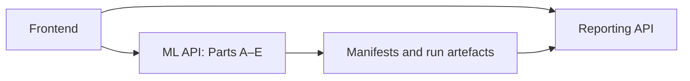

# Telecom KPI Anomaly Detection — ML Backend

FastAPI pipeline for the Telecom KPI Anomaly Detection and Monitoring Platform: dataset analysis, preprocessing, feature engineering, model training, and inference using saved artefacts.

Developed by Aditya Pramod Pawar under the mentorship of Sanjana Chaudhary.

## Architecture

The [frontend](https://github.com/Bored-Pawar/JIO_ML_APPLICATION-FRONTEND) configures workflows and tracks execution through this API. The [reporting backend](https://github.com/Bored-Pawar/REPORTING_BACKEND_JIO) reads saved results directly from shared run storage; it does not execute ML workflows.



## Parts A–E

| Part | Responsibility |
| --- | --- |
| A | EDA, dataset preparation, site/server validation, timeline gaps, duplicates and quality summaries. |
| B | Timeline correction, missing-data/gap handling, IQR outlier handling, safe/risk fill logic and optional Prophet fallback. |
| C | Lag, rolling, calendar, baseline, residual and value features; corrected-history and point-cleaning options; model-specific profiles or custom features. |
| D | XGBoost or Isolation Forest training with fixed parameters or Optuna tuning; evaluation, calibration/residual thresholds where applicable, and saved model artefacts. |
| E | Inference using saved trained artefacts and history cache. Eligible late data inside the cache can be reconstructed through A → B → C without retraining. |

Training finishes with inference bootstrap, which establishes history and readiness. Part E is invoked separately for new observations.

Earlier algorithm-selection experiments used Jio AMF and synthetic data. Historic experiments achieved F1 above 98%, as reported in the project context; this is not a guarantee for every dataset, model or run. A reproducible benchmark reference is still needed.

## Guided versus Quick Training

**Guided Training** executes A–D through standalone stage endpoints. Inspect each stage before proceeding. Run management validates handoffs and recovery legality; recover through the relevant stage endpoint rather than resubmitting the master request.

**Quick Training, new run:** the frontend uses `POST /api/v1/pipeline/master-pipeline-request-acknowledgement-return`. After request and CSV validation, the API creates a run, submits background work, and returns `run_id`, `status: "created"`, and `attempt_id: null`. The worker creates the attempt. Acknowledgement confirms acceptance, not training completion. Poll `GET /api/v1/runs/{run_id}`, then `GET /api/v1/runs/{run_id}/attempts/{attempt_id}` for progress. The acknowledgement endpoint rejects a supplied `run_id`.

**Quick Training, existing run:** `POST /api/v1/pipeline/run` with `run_id` creates a fresh attempt and waits for the pipeline response. This synchronous endpoint also supports a new run when `run_id` is omitted, but the frontend uses acknowledgement for new runs. Master submissions never resume failed attempts.

The background runner is an in-process `ThreadPoolExecutor` with two workers and eight admission slots, including running work. Accepted work is not guaranteed to survive server restart; cancellation is unsupported. Submission failure can leave a created run for inspection. The UI blocks duplicate pending submissions and never automatically resubmits uncertain or failed requests.

## Run tracking and artefacts

Tracking follows **run → attempt → stage → execution**. Manifest V2 records lifecycle and successful-execution references; the local JSON registry supports run discovery. Saved stage snapshots, intermediate CSVs, models/training summaries, inference requests/results and history cache support inspection and controlled recovery. Component logs record activity. Preserve complete run directories and manifest references when relocating storage.

## Stack and layout

Python, FastAPI, Uvicorn, Pydantic/Pydantic Settings, pandas, NumPy, scikit-learn, XGBoost, Prophet, Optuna, Matplotlib and joblib. Runtime pins are in [requirements.txt](requirements.txt), except the missing Optuna dependency noted below.

```text
app/main.py           Application assembly and CORS
app/api/              Health, run inspection, pipeline and stage routes
app/schemas/          Dataset and workflow configuration contracts
app/workflows/        Orchestration, handoffs and inference bootstrap
app/ml/               Parts A–E implementation
app/run_management/   Registry, locking, lifecycle and artefact resolution
app/services/         Files, manifests and background execution
app/core/             Settings, logging and exceptions
docs/                 Detailed backend notes currently available locally
runs/                 Generated manifests and run artefacts
run_registry/         Generated JSON registry
logs/                 Generated component logs
model_artifacts/      Model storage directories
```

## Setup and configuration

Run from this repository root. The inspected local interpreter is Python 3.12; the supported version range is not declared. Input CSVs must be readable by the backend process and output storage writable. A path entered in the browser is a server-side path, not a browser upload. Configure column mappings, KPI selection, bucket cadence and timeline bounds to match the CSV.

PowerShell:

```powershell
python -m venv .venv
.\.venv\Scripts\Activate.ps1
python -m pip install -r requirements.txt
python -m pip install optuna
$env:DEBUG = 'false'
python -m uvicorn app.main:app --host 127.0.0.1 --port 8000
```

Optuna is imported by training modules but absent from `requirements.txt`; the separate install is required even for application import. Its intended version is not pinned. On POSIX shells use `source .venv/bin/activate` and `export DEBUG=false`.

Settings read `.env` at this repository root; process variables take precedence. No `.env.example` is present. Useful variables include `PROJECT_ROOT`, `RUN_REGISTRY_ROOT`, `RUN_REGISTRY_BACKEND` (currently `local_json`), `LOG_LEVEL`, `DEBUG`, `MAX_INPUT_FILE_SIZE_GB` (default 5), and `DEFAULT_FILE_ENCODING` (UTF-8). Storage defaults to this repository's `runs/`, `logs/`, `model_artifacts/` and `run_registry/`. Prefer absolute override paths.

Uvicorn defaults to **127.0.0.1:8000**, explicitly selected above. Change `--host`/`--port` to change the listener; no ML host/port fields exist in `Settings`. Update the frontend ML base URL and restart Vite after changing ports. Route prefixes are declared in router modules; changing `API_PREFIX` alone does not relocate them.

Request options cover dataset mapping/timeline, outlier/fill rules, feature profiles/custom features, model selection/tuning/calibration, and bootstrap gap/cache controls. See Pydantic schemas and OpenAPI for field-level contracts.

## API documentation and checks

At the address above: [Swagger UI](http://127.0.0.1:8000/docs), [ReDoc](http://127.0.0.1:8000/redoc), and [OpenAPI JSON](http://127.0.0.1:8000/openapi.json). `GET /health` checks liveness. Standalone stages are `POST /api/v1/eda/run`, `/api/v1/preprocessing/run`, `/api/v1/feature-engineering/run`, `/api/v1/training/run`, and `/api/v1/inference/run`.

The focused acknowledgement tests require pytest, absent from runtime requirements:

```powershell
python -m pip install pytest
python -m pytest app/api/test/test_master_pipeline_acknowledgement.py -q
Invoke-RestMethod http://127.0.0.1:8000/health
```

`app/schemas/test/`, `app/api/test/`, `app/workflows/test_pipeline_workflows/` and `app/test_main/` also contain historical schema, route, workflow and application harnesses. Their READMEs describe development-time placement. These are not a verified turnkey integration/system suite; inspect imports and data prerequisites before running them.

## Troubleshooting and limitations

- Optuna import error: install it in the interpreter running Uvicorn.
- Address already in use: a process already owns the port; reuse the intended server or choose another `--port` and update the frontend URL.
- `DEBUG` validation failure: use `true` or `false`. The inspected host supplied `DEBUG=release`, overriding file configuration.
- CSV validation failure: check server-side path, extension, encoding, size, required columns and nonempty rows.
- Browser CORS failure: ML currently hard-codes `http://localhost:5173` and `http://127.0.0.1:5173`. Another frontend origin requires a separately authorized code change.
- Lost acknowledgement or timeout: inspect Runs before another submission. Keep the backend alive during background work; development reload can interrupt it.
- Missing/incomplete artefacts: inspect attempt/stage status and logs before recovery. Reporting requires saved completed executions.

No Docker/Compose files were found. Local registry/locking and in-process execution do not establish a verified distributed or multi-worker deployment contract.

## Detailed documentation present in documentation.zip